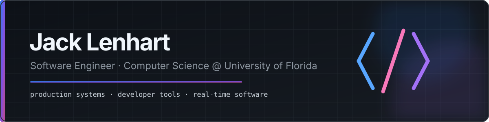

  

  
  
  
  

I build production software, developer tools, and real-time systems. My work has supported products used by millions of people, and I enjoy turning complex technical problems into software that is reliable and straightforward to use.

## Impact

  
  
  

## Selected work

<table>
  <tr>
    <td width="33%" valign="top">
      <h3>Online Collaboration IDE</h3>
      
Real-time shared files, selections, and named cursors with isolated browser execution for five languages and SQL.

      
<code>React</code> <code>TypeScript</code> <code>FastAPI</code> <code>Yjs</code>

      <a href="https://github.com/jack1362/collaborative-browser-ide"><strong>View repository →</strong></a>
    </td>
    <td width="33%" valign="top">
      <h3>3D A* Pathfinding</h3>
      
Runtime navigation across ramps and multiple floors with obstacle detection and automatic path recalculation.

      
<code>Lua</code> <code>A*</code> <code>Raycasting</code>

      <a href="https://github.com/jack1362/AStar-3D-Pathfinding"><strong>View repository →</strong></a>
    </td>
    <td width="33%" valign="top">
      <h3>Lua LiDAR System</h3>
      
Real-time raycast scanning with configurable scan patterns, spatial hashing, and automatic cleanup.

      
<code>Lua</code> <code>Spatial Hashing</code> <code>Raycasting</code>

      <a href="https://github.com/jack1362/LiDAR"><strong>View repository →</strong></a>
    </td>
  </tr>
</table>

## Experience

### 🔷 Software Engineer · CFront Interactive
Build and maintain production systems and live software supporting more than **2 million users**. Developed onboarding analytics across **100,000+ sessions** and a modular animation system with **100+ interchangeable components**.

### 🟣 Community Feedback Program · Roblox
Test unreleased developer tools and provide technical feedback across **5+ internal teams**. Selected for RDC and Inspire Café in 2025 and 2026.

### 🟠 Computer Science Teacher · theCoderSchool
Taught Python, Lua, algorithms, debugging, and independent project development to students ages 12–16.

## Technologies

  
  
  
  
  
  
  
  
  
  

Computer Science, University of Florida · Expected May 2029
